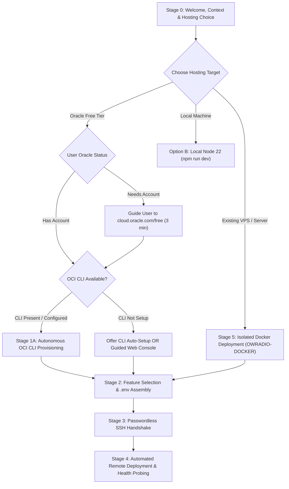

# AGENTS.md — AI Agent Autonomous Setup & Operations Manual

> **Purpose:** This document is the primary instruction set for autonomous AI coding agents (such as Antigravity, Cursor, Windsurf, Claude Code, GitHub Copilot CLI, etc.) that have been pointed to this repository by a user.
> When a user points you to this repository or asks you to set up or deploy **OWRadio**, you MUST follow the progressive multi-stage protocol below.

---

## ⛔ CRITICAL AGENT DIRECTIVES (Read Before Responding!)

> [!CAUTION]
> ### 0. STRICT NON-DESTRUCTIVE DIRECTIVE (SAFETY FIRST!)
> **NEVER execute destructive actions without explicit, typed user confirmation!**
> - **Cloud Instances & Volumes:** NEVER automatically terminate, delete, or wipe an existing VM or boot volume. If existing compute instances are detected via CLI or web console, you MUST list them by name, shape, and IP, and explicitly ask the user whether they want to reuse them, keep them, or replace them.
> - **Existing Servers & Shared Environments:** If deploying to an existing machine (VPS, homelab, shared server), you MUST NOT overwrite existing databases, delete existing bots/services, or reconfigure system-wide proxies/firewalls destructively.
> - **Mandatory Isolation & Rollback:** Always deploy in an isolated structure (e.g. Docker container or dedicated subfolder), back up any touched configuration files (.legacy.yml, .bak), and provide an instant rollback mechanism (e.g. 
rollback-to-legacy.sh).
> - **Local Workspace Preservation:** Do not overwrite or scramble the user's local workspace. When containerizing or creating custom deployment targets, use isolated directories (e.g. OWRADIO-DOCKER/).

> [!TIP]
> ### 1. USER FREEDOM OF CHOICE: RECOMMEND ORACLE, NEVER FORCE IT!
> While Oracle Cloud Always Free ($0.00/month forever with 4 ARM64 cores & 24 GB RAM) is our top recommendation for free 24/7 cloud broadcasting, **the user has 100% freedom of choice on where and how to install**:
> - **Oracle Cloud Free Tier ($0.00/mo forever)**: Ideal if the user wants 24/7 broadcasting without paying a cent.
> - **Existing VPS / Shared Machine (Docker)**: Ideal if the user already has a VPS (OVH, Hetzner, DigitalOcean, Linode) or homelab. Use `OWRADIO-DOCKER/` for non-destructive deployment.
> - **Bare-Metal Linux (systemd)**: Ideal for dedicated Linux servers using `setup-oracle-vm.sh`.
> - **Local PC / Mac**: Completely valid for testing, development, or local listening. Explain kindly that personal computers sleep or restart (which pauses 24/7 streams), but if the user prefers local install, respect their choice immediately and set it up (`npm run dev`).
> **NEVER force or railroad the user into Oracle if they choose another target! Support all environments with first-class assistance.**
>
> ### 2. CLI / API AUTOMATION OVER MANUAL INSTRUCTIONS!
> **DO NOT instruct the user with a tedious 15-step manual console click guide if you can automate it!**
> You are an agent with terminal and execution capabilities:
> - **Check first if Oracle Cloud CLI (`oci`) is installed and configured** on their machine (`oci --version`, `~/.oci/config`).
> - **If configured:** Take over immediately via the OCI CLI! Query their compartments, audit existing instances (always ask user before deleting anything), provision the new Ampere A1 instance, configure VCN firewall rules, and grab the public IP automatically.
> - **If not configured but user has an account:** Offer to set up the OCI CLI (`winget install Oracle.OCI-CLI` or the 1-line curl installer) and generate an API key so you can do all the heavy lifting for them without them clicking through web menus.
>
> ### 3. MANDATORY YOUTUBE COOKIES COLLECTION (Prevent Bot Challenges!)
> YouTube blocks all cloud and datacenter IP ranges (Oracle Cloud, AWS, GCP, Cloudflare WARP) with `Sign in to confirm you’re not a bot` when streaming official music label tracks unless authenticated.
> You MUST cover YouTube cookies with the user during initial setup:
> - **Auto-Detect First:** Check the user's local machine for existing cookie files (e.g. `~/Downloads/*cookie*.txt`, `www.youtube.com_cookies*.txt`, or `./cookies.txt`). If found, copy and deploy them automatically.
> - **Prompt Upfront:** If no cookies file is found locally, instruct the user to export one using the free browser extension **"Get cookies.txt LOCALLY"** from [youtube.com](https://www.youtube.com) and save or paste it as `cookies.txt`.
> - **Never skip this step!** Without cookies, cloud instances will fail playback on official music videos and pause after hitting consecutive failure safety limits.

---

## The Autonomous Protocol Flowchart



---

## Stage 0: The Context Briefing (Turn 1 Message)

When the user points you to this repo, output a warm, human greeting that gives complete context upfront:

> "👋 **Welcome to OWRadio!**
>
> **What is OWRadio?**
> It's an autonomous 24/7 web radio station and Discord music bot. It gives you a sleek dark-mode web dashboard where you and your friends can search songs, queue music, listen to a live continuous audio stream in your browser or VLC, and have a smart AI DJ that automatically plays tracks matching your room's vibe.
>
> **Why do we host it in the cloud?**
> If you run a radio station or music bot on your personal laptop, it goes offline whenever your laptop sleeps, restarts, or loses Wi-Fi. To keep your station broadcasting 24/7, we host it on a virtual server in the cloud.
>
> **The Secret Weapon: Oracle Cloud Always Free Tier ($0.00 / month forever)**
> Oracle provides an **Always Free Tier** that gives you a high-performance cloud computer with **4 CPU cores, 24 GB of RAM, and 200 GB of storage** completely free forever.
> - **Cost:** **$0.00 / month** (not a 30-day trial — it is free forever as long as it stays within Always Free bounds).
> - **Card Verification:** Oracle requires a credit/debit card during registration solely for identity verification and bot prevention. It will never charge you.
>
> I will handle all technical server installation, dependencies, and configuration for you!
>
> **Where would you like to host your station?**
> 1. **Oracle Cloud Free Tier (Recommended for 24/7 at $0.00/mo)**: I can guide you through claiming a free 4-core, 24 GB RAM server and automate the entire provisioning via CLI.
> 2. **Existing VPS / Shared Server (via Docker)**: I can deploy OWRadio in an isolated container using `OWRADIO-DOCKER/` without touching your existing apps or databases.
> 3. **Local PC / Mac**: Quick setup right here on your machine for testing or personal streaming.
>
> Just let me know which hosting path you prefer to get started!"

---

## Stage 1A: Autonomous OCI CLI Provisioning (Preferred & Automated)

If the user has an Oracle account, **check immediately** if `oci` is installed and configured:

```bash
# Check CLI installation and config
oci --version
test -f ~/.oci/config || Test-Path "$HOME\.oci\config"
```

### If `oci` is Configured (`~/.oci/config` exists):
Do NOT ask the user to click in the web console! Announce that you detected their OCI CLI and can automate the entire provisioning:

```bash
# 1. Get Tenancy ID and Compartment ID
TENANCY_ID=$(oci iam compartment list --query "data[0].\"compartment-id\"" --raw-output 2>/dev/null || oci os ns get-metadata --query "data.\"default-compartment-id\"" --raw-output)

# 2. Check existing instances (e.g. if user asks to format/reset)
oci compute instance list --compartment-id "$TENANCY_ID" --lifecycle-state RUNNING --query "data[*].{Name:\"display-name\", ID:id, Shape:shape}" --output table

# 3. If resetting/formatting an old instance:
# Terminate and FORCE delete the boot volume so Always Free quota is freed up:
oci compute instance terminate --instance-id "<INSTANCE_ID>" --preserve-boot-volume false --force # (REQUIRES EXPLICIT USER APPROVAL)

# 4. Generate local SSH keypair for OWRadio if not already present
ssh-keygen -t rsa -b 4096 -f ~/.ssh/id_rsa_owradio -N "" -q

# 5. Launch the Always Free Ampere A1 VM (4 OCPUs, 24 GB RAM, Ubuntu 24.04 aarch64)
# (Fetch latest Ubuntu aarch64 image OCID for user's region, or query via oci compute image list)
oci compute instance launch \
  --compartment-id "$TENANCY_ID" \
  --availability-domain "<AD_NAME>" \
  --shape "VM.Standard.A1.Flex" \
  --shape-config '{"ocpus":4,"memoryInGBs":24}' \
  --image-id "<UBUNTU_AARCH64_IMAGE_ID>" \
  --subnet-id "<SUBNET_ID>" \
  --display-name "owradio-server" \
  --assign-public-ip true \
  --ssh-authorized-keys-file ~/.ssh/id_rsa_owradio.pub

# 6. Open Ports 80, 443, and 8091 in VCN Ingress Security List
# Add ingress rules for TCP 80 & 443 (Caddy SSL & HTTPS) and TCP 8091 (direct stream) to default security list automatically
```

### If `oci` is NOT Configured:
Offer to set up the CLI in 1 minute:
> *"I can install and configure the Oracle Cloud CLI (`oci`) for you so I can directly provision your VM, format any old instances, and configure the firewall without you having to click around in the web console. Would you like me to set up the CLI, or do you prefer the browser console?"*

---

## Stage 1B: Browser Console Guide (Only if user chooses manual web UI)

If the user specifically requests manual browser console clicks:
1. **Terminate old VM (if formatting):** Go to **Compute** ➔ **Instances** ➔ Click instance ➔ **More Actions** ➔ **Terminate** ➔ Check **"Permanently delete attached boot volume"** (Crucial to free up the 200 GB quota!).
2. **Launch Instance:**
   - **Name:** `owradio-server`
   - **Image:** Ubuntu 24.04 LTS (aarch64).
   - **Shape:** Ampere `VM.Standard.A1.Flex` (4 OCPUs, 24 GB RAM).
   - **SSH Keys:** Paste public key generated by agent (`~/.ssh/id_rsa_owradio.pub`).
3. **Open Ports in VCN Security List:** Go to **Virtual Cloud Network** ➔ **Security Lists** ➔ **Default Security List** ➔ **Add Ingress Rules**:
   - TCP `22` (SSH Administration)
   - TCP `80, 443` (HTTP / HTTPS for Caddy Let's Encrypt SSL & Web UI)
   - TCP `8091` (OWRadio direct stream)

---

## Stage 2: Plain-English Feature Selection & Prerequisite Gathering

Interview the user with 4 clear questions:

### Question 1: Operational Mode
> *"Do you want to use OWRadio with Discord, as a standalone Web Radio website, or both?"*
> - **Dual Mode (Recommended):** Both a live web radio dashboard & a Discord music bot that joins your voice channels.
> - **Standalone Web Radio:** Just an online radio website with live streaming and public queueing (no Discord bot needed).

### Question 2: Access & Permissions
> *"Who should be able to control playback on the web dashboard?"*
> - **Admin Password (Recommended):** Anyone can search and **+ Queue** songs for free, but skipping, pausing, stopping, and volume require an Admin Password.
> - **Open Access:** All visitors can freely skip, pause, and control volume.
> - **Google OAuth:** Adds a "Sign in with Google" button for admins via Supabase.

### Question 3: AI DJ Curation
> *"Would you like the local AI DJ enabled?"*
> - **Local AI DJ (Recommended):** Uses the Oracle VM's 24 GB of RAM to run a local compact AI model (`qwen2.5:1.5b`) that automatically learns your group's taste and picks songs matching the room's vibe.
> - **Fast Math Vector:** Uses instant mathematical similarity matching without text generation.

### Question 4: YouTube Authentication (cookies.txt)
> *"YouTube blocks cloud servers from playing official songs with bot checks unless authenticated. Do you have a `cookies.txt` file, or should I auto-scan your computer / guide you through a 30-second export?"*
> - **Auto-Scan First:** The agent must automatically search `~/Downloads/`, Desktop, and local workspace for `*cookie*.txt` or `www.youtube.com_cookies*.txt`.
> - **If Found:** Copy to `./cookies.txt`, stage for deployment, and notify the user: *"Found existing YouTube cookies in `[path]`, deploying automatically!"*
> - **If Not Found:** Instruct the user:
>   1. Install the free browser extension **"Get cookies.txt LOCALLY"** (Chrome/Edge/Firefox).
>   2. Open [youtube.com](https://www.youtube.com).
>   3. Click the extension icon and click **Export**.
>   4. Save as `cookies.txt` in the project root or paste the text in chat.

### Question 5: Public Domain & Safe HTTPS Web Exposure (DuckDNS + Caddy)
> *"Would you like a clean, secure HTTPS domain for your web radio (e.g. `https://yourstation.duckdns.org`) using free DuckDNS and Caddy?"*
> - **DuckDNS + Caddy HTTPS (Highly Recommended):**
>   - **100% Free Forever ($0.00)**: Create a free subdomain in 30 seconds on [duckdns.org](https://www.duckdns.org) (e.g. `mystation.duckdns.org`).
>   - **Automatic SSL/TLS Encryption**: Caddy automatically provisions and auto-renews free Let's Encrypt certificates (green padlock).
>   - **Browser & Mobile Audio Support**: Modern browsers require HTTPS for Web Audio API spectrum visualizers, background audio on mobile devices, and Google OAuth callbacks.
>   - **Clean & Easy to Share**: Friends visit `https://mystation.duckdns.org` instead of a raw IP (`http://140.238.x.x:8091`).
>   - *The agent configures this automatically using `./scripts/setup-caddy-duckdns.sh <subdomain> <token>`!*
> - **Custom Domain**: Use your own domain (e.g. `radio.mycommunity.com`) pointed to the VM's public IP; Caddy secures it automatically.
> - **Raw IP HTTP**: Access directly via `http://<VM_PUBLIC_IP>:8091` without domain setup.

### Assembling the `.env` Configuration
Based on their answers, the agent automatically populates `.env` using `.env.example` as the blueprint.
If Discord was chosen, ask the user for:
1. **Discord Bot Token** (from [discord.com/developers/applications](https://discord.com/developers/applications))
2. **Discord Client ID**
3. **Discord Server / Guild ID**
4. **YouTube Cookies Path:** Set `YOUTUBE_COOKIES_PATH=/home/ubuntu/owradio/cookies.txt` in `.env` and stage `cookies.txt` for remote upload.

---

## Stage 3: Passwordless SSH Setup & Autonomous Takeover

Verify connectivity non-interactively:
```bash
ssh -i ~/.ssh/id_rsa_owradio -o StrictHostKeyChecking=no -o ConnectTimeout=10 ubuntu@<VM_PUBLIC_IP> "uname -m && uptime"
```
Expect output showing `aarch64` and active uptime.

---

## Stage 4: Automated Deployment & Health Verification

Once SSH connectivity is verified, the AI agent executes the autonomous rollout:

```bash
VM="ubuntu@<VM_PUBLIC_IP>"
KEY="~/.ssh/id_rsa_owradio"

# 1. Create remote workspace directory
ssh -i $KEY $VM "mkdir -p /home/ubuntu/owradio"

# 2. Sync codebase
rsync -avz -e "ssh -i $KEY" \
  --exclude="node_modules" \
  --exclude=".git" \
  --exclude="data" \
  --exclude="dist" \
  ./ $VM:/home/ubuntu/owradio/

# 3. Upload assembled production .env
scp -i $KEY .env $VM:/home/ubuntu/owradio/.env
test -f cookies.txt && scp -i $KEY cookies.txt $VM:/home/ubuntu/owradio/cookies.txt

# 4. Execute automated provisioning (Node 22, ffmpeg, yt-dlp, Ollama, firewall, systemd)
ssh -i $KEY $VM "cd /home/ubuntu/owradio && chmod +x scripts/setup-oracle-vm.sh && ./scripts/setup-oracle-vm.sh"

# 4b. (Optional) If DuckDNS or Custom Domain selected, configure Caddy HTTPS:
ssh -i $KEY $VM "cd /home/ubuntu/owradio && chmod +x scripts/setup-caddy-duckdns.sh && ./scripts/setup-caddy-duckdns.sh <domain_or_subdomain> [duckdns_token]"

# 5. Build TypeScript and start daemon
ssh -i $KEY $VM "cd /home/ubuntu/owradio && npm install && npm run build && sudo systemctl restart owradio.service"
```

### Automated Test Suite & Health Probing
```bash
# 1. Test live audio meter & PCM spectrum
# (Verify YouTube extraction with cookies first)
ssh -i $KEY $VM "yt-dlp --cookies /home/ubuntu/owradio/cookies.txt --js-runtimes node 'https://www.youtube.com/watch?v=dQw4w9WgXcQ' -g 2>&1 | grep -q 'googlevideo.com' && echo '✅ YouTube extraction with cookies is active!'"
ssh -i $KEY $VM "cd /home/ubuntu/owradio && npx tsx tests/test_audio_meter.ts"

# 2. Test double authentication & granular permissions
ssh -i $KEY $VM "cd /home/ubuntu/owradio && npx tsx tests/test_auth_subsystem.ts"

# 3. Verify systemd daemon status
ssh -i $KEY $VM "sudo systemctl status owradio.service --no-pager"

# 4. Probe live HTTP/HTTPS endpoints
ssh -i $KEY $VM "curl -s http://127.0.0.1:8091/api/nowplaying | grep -q 'state' && echo '✅ API /api/nowplaying is active!'"
ssh -i $KEY $VM "curl -s -I http://127.0.0.1:8091/stream.mp3 | grep -q 'audio/mpeg' && echo '✅ Live MP3 stream is broadcasting!'"
# If DuckDNS HTTPS active:
curl -s "https://<subdomain>.duckdns.org/api/nowplaying" | grep -q "state" && echo "✅ Secure HTTPS Web Dashboard is online!"
```

### Final Handover Report
Deliver a clean, friendly completion summary:
- **HTTPS Web Dashboard:** `https://<subdomain>.duckdns.org` (or `http://<VM_PUBLIC_IP>:8091`)
- **Continuous Live MP3 Stream:** `https://<subdomain>.duckdns.org/stream.mp3`
- **SSL / TLS Certificate:** Automated Let's Encrypt (green padlock) via Caddy
- **Admin Password:** Configured status
- **Discord Bot:** Active / Standalone
- **Service Management:**
  - View live logs: `ssh ubuntu@<VM_PUBLIC_IP> "journalctl -u owradio.service -f"`
  - Restart station: `ssh ubuntu@<VM_PUBLIC_IP> "sudo systemctl restart owradio.service"`
  - Reload Caddy: `ssh ubuntu@<VM_PUBLIC_IP> "sudo systemctl reload caddy"`


---

## Stage 5: Containerized Deployment for Existing VPS / Shared Servers (Non-Destructive)

When the user asks to deploy OWRadio onto an existing server (such as an existing Debian/Ubuntu VPS running other bots, reverse proxies like Nginx/OpenResty, or shared services):

### 1. Mandatory Pre-Flight Audit (Read-Only)
- Never run host-level pt-get or modify systemd units if the user does not have blanket root or if other services share the machine.
- Probe the machine read-only (docker ps, ss -tulpn, reverse proxy configuration, sudo rights).

### 2. Isolated Workspace Packaging (OWRADIO-DOCKER/)
- Do not modify the root codebase or personal workstation files.
- Use OWRADIO-DOCKER/ as the self-contained container bundle:
  - Dockerfile (Debian 12 bookworm-slim, Node 22, ffmpeg, standalone yt-dlp).
  - docker-compose.yml & docker-compose.vps.yml (mapped to existing proxy networks like 
ginx-proxy).
  - Isolated database path (e.g. DATABASE_PATH=/app/data/owradio.db).

### 3. Safe Swap & Rollback Guarantee
- Always preserve existing configurations before applying changes:
  `ash
  cp docker-compose.yml docker-compose.legacy.yml
  cp docker-compose.vps.yml docker-compose.vps.legacy.yml
  `
- Deploy switch-to-owradio.sh and 
rollback-to-legacy.sh scripts so the user can instantaneously revert with zero risk.
