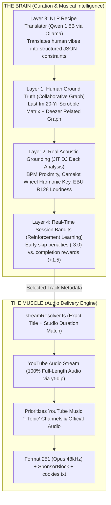
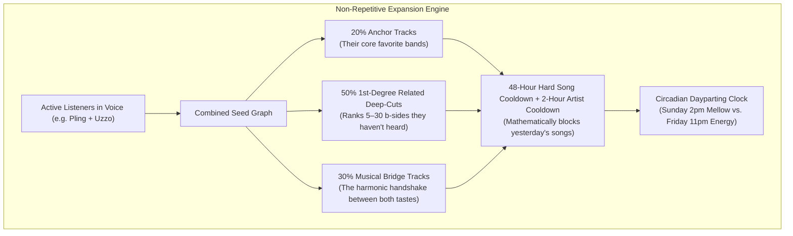
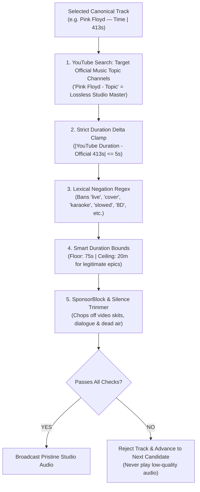

# BRAIN-PLAN-TODO.MD — OWRadio Autonomous Curation Brain

> **Status:** 🔒 **Macro Planning Locked In**  
> **Last Updated:** November 2026  
> **Target Platform:** Oracle Cloud Infrastructure (Always Free Ampere A1, 4 ARM OCPUs, 24 GB RAM, Headless Ubuntu 24.04, No GPU)

---

## 1. Architectural Philosophy: The Decoupled Hybrid Model

OWRadio enforces a strict architectural boundary between **The Brain** (Curation, Taste Discovery, Musical Logic) and **The Muscle** (Audio Streaming, High-Bitrate Decoding, Voice Gateway):



---

## 2. Deprecation of the Static 50k Database Model

### Why the Old 50k Pre-Crawl is Obsolete
* **The Old Paradigm:** Crawl 50,000 tracks into SQLite over 70+ hours, generate 384-d `all-minilm` text embeddings, and search offline in RAM.
* **The Flaws:**
  1. High storage bloat and unnecessary API hammering for tracks that may never be played.
  2. Text embeddings are linguistic heuristics (~75% accurate); they do not hear audio waveforms and suffer from lexical traps (e.g. death metal songs with "Love" in the title matching pop).
  3. Static catalog: limits the station to an arbitrary 50k snapshot instead of the living music world.

### The New Standard: Just-In-Time (JIT) Dynamic Discovery
* **Infinite Music Galaxy (100M+ Songs):** Queries Deezer and Last.fm open graphs live on-demand in **300ms**.
* **Zero Database Bloat:** SQLite only stores what was **actually played** (history, 48h/2h anti-repetition cooldown, and listener affinities). Typical DB size stays under 10 MB.
* **Immediate Availability:** Zero startup or scraping wait time; the AI DJ is fully primed on boot.

---

## 3. Macro Brick 1: User Taste Onboarding & Anti-Echo Chamber Engine

### Respectful 1-Time Onboarding (No Creepy Telemetry)
* **What is Explicitly Discarded:**
  * ❌ No Spotify presence sniffing (invasive/creepy).
  * ❌ No voice channel join/leave tracking (statistically invalid; people leave for non-music reasons).
  * ❌ No voice chatter / speaking dynamics analysis.
* **Voluntary 1-Time Onboarding Options:**
  * **Option A (The "Taste DNA" — Preferred):** User drops 1 Spotify or YouTube playlist URL via `/taste playlist <url>`. The bot parses the tracklist in 2 seconds to extract their top artists, favorite decades, and genre anchors.
  * **Option B (Fast Slash Command):** User runs `/taste artists Daft Punk, Radiohead, Steely Dan, The Cure`.
  * **Option C (Zero Effort):** If a user never onboards, the bot uses the server default vintage vault.

### The Anti-Echo Chamber Engine (Solving the "Pling + Uzzo" Loop)
When the same passive listeners sit in voice for hours, the bot prevents repetitive looping using **3 Musical Shields**:



1. **Degrees of Separation Pacing:**
   * **20% Core Anchors:** Familiar comfort tracks from their explicit seeds.
   * **50% 1st-Degree Related Deep-Cuts:** Collaborative graph mines ranks 5–30 of related artists (e.g. Donald Fagen or Doobie Brothers b-sides for Steely Dan fans).
   * **30% The Musical Bridge:** Finds transitional artists that bridge both users' tastes (e.g., 70s Funk-Rock or Talking Heads bridging Funk and Classic Rock).
2. **Immutable Cooldown Shields:**
   * **48-Hour Song Cooldown:** Zero songs can repeat within 48 hours.
   * **2-Hour Artist Cooldown:** Prevents same-artist back-to-back clustering.
3. **Circadian Dayparting Clock:**
   * Day of week and time of day modulate the active branch of the graph (e.g., acoustic/coffee focus during morning hours; high-energy grooves during weekend nights).

---

## 4. Macro Brick 2: Content & Purity Filtering (Zero Garbage Audio)

The bot enforces a multi-stage purity defense to permanently eliminate karaoke, live bootlegs, amateur covers, meme edits, and loops:



### 1. YouTube Music Topic Channels (`- Topic`) Priority
* Channels ending in `- Topic` (e.g., `Radiohead - Topic`) are direct label-distributed studio masters.
* They contain **zero video skits, zero dialogue, and zero crowd noise**.
* `streamResolver.ts` awards a **+15 bonus score** to Topic releases with matching duration.

### 2. The $\pm 5$-Second Duration Delta Clamp (The Ultimate Fake Killer)
* Deezer/MusicBrainz provides the canonical album duration down to the second.
* **The Rule:** $\Delta = |\text{YouTube Duration} - \text{Canonical Duration}| \le 5\text{s}$ (accepted up to $\le 12\text{s}$ for alternate album master fades).
* **Why this is critical:** A 4-minute song will **never** accidentally match a 45-minute full album rip, a 1-hour loop, or a 15-minute extended jam, because the delta is hundreds of seconds off.

### 3. Smart Duration Boundaries (Autoplay Flow vs. Manual Freedom)
* **Manual `/play` Queue:** **No ceiling** (user is king; if someone explicitly requests a 15-minute epic like *Telegraph Road* or *Shine On You Crazy Diamond*, honor it completely).
* **Autoplay Ceiling:** **8 minutes (480 seconds)**.
  * *Rationale:* Keeps automated radio rotation lively, engaging, and dynamic. Prevents passive autoplay from drifting into 15-minute rambling jams, while explicit user requests remain completely unrestricted.
* **Absolute Floor:** **75 seconds** (discards ringtones, TikTok teasers, and voice skits).

### 4. Lexical Negation Regex & Smart Exemption
* **Banned Tokens:**
  ```regex
  \b(karaoke|instrumental|backing track|tribute|remake|parody|lesson|tutorial|guitar tab|acoustic cover|cover by|slowed \+ reverb|slowed and reverb|8d audio|nightcore|bass boosted|full album|compilation|live at|live from|in concert|live 19\d\d|live 20\d\d)\b
  ```
* **Smart Exemption Rule:** If the banned word was **already in the official album title** (e.g., the band *Live*, or *New Order - Blue Monday (12" Mix)*), it is exempted. Only terms injected by YouTube uploaders trigger a rejection.

### 5. Fail-Closed Rejection
* If no YouTube candidate passes the purity checks ($\Delta \le 12\text{s}$ or clean title):
* **The bot never settles for a low-grade live bootleg or amateur cover.**
* It immediately skips the track and advances to the next collaborative candidate with zero audio interruption.

---

## 5. Implementation Checklist & Future Milestones

- [ ] **Phase 1: JIT Collaborative Graph Connector**
  - [ ] Add Last.fm open API client (`artist.getSimilar`, `track.getSimilar`) as a peer to Deezer.
  - [ ] Create unified `CollaborativeGraphService` returning human-verified candidate pools.
- [ ] **Phase 2: Local Qwen Recipe Translator Service**
  - [ ] Implement `RecipeTranslator` service calling Ollama `qwen2.5:1.5b` with strict JSON mode.
  - [ ] Wire `/vibe <prompt>` slash command and web UI prompt box directly to `RecipeTranslator`.
- [ ] **Phase 3: 1-Time Onboarding & Anti-Echo Chamber Engine**
  - [ ] Implement `/taste playlist <url>` and `/taste artists <list>` commands.
  - [ ] Implement 20/50/30 Degrees of Separation queue selector.
- [ ] **Phase 4: Purity & Smart Duration Upgrade**
  - [ ] Enforce 8-minute (480s) autoplay ceiling while keeping manual `/play` queue unlimited.
  - [ ] Implement strict $\Delta \le 5\text{s}$ duration delta clamp in `streamResolver.ts`.
  - [ ] Upgrade lexical negation regex with smart title exemption.
- [ ] **Phase 5: JIT Acoustic & Camelot Wheel Reranker**
  - [ ] Add fast PCM/metadata BPM & Key inspection to pre-buffered standby decks in `GuildPlayer.ts`.
  - [ ] Implement Camelot Wheel adjacency scoring (+0.25 bonus for harmonic compatibility).
- [ ] **Phase 6: Session Bandit & Affinity Weights**
  - [ ] Track skip timestamps (<30s) and completion events in `GuildPlayer.ts`.
  - [ ] Feed real-time penalties/rewards directly into `user_preferences`.
- [ ] **Phase 7: Web UI Modernization**
  - [ ] Replace 50k countdown card with the Live Hybrid Engine card in `index.html` & `app.js`.
